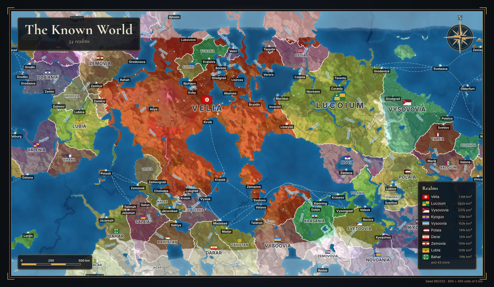
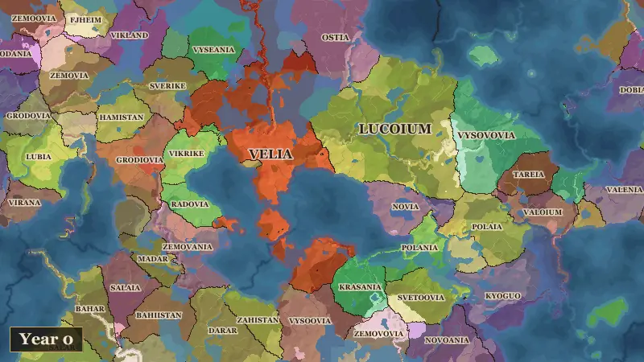
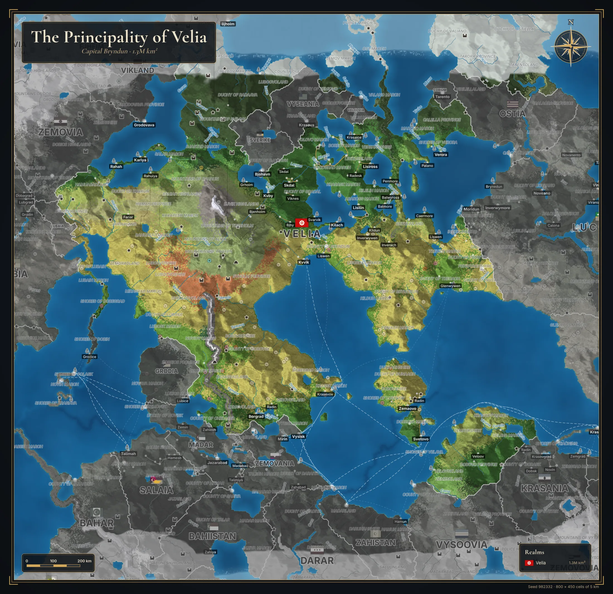
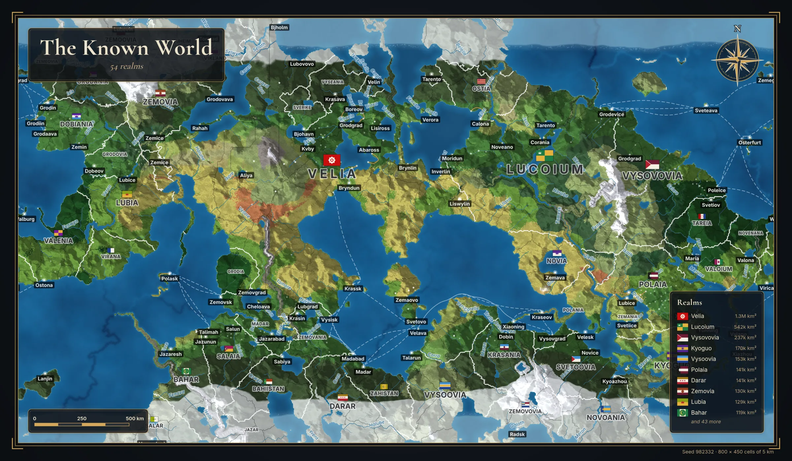
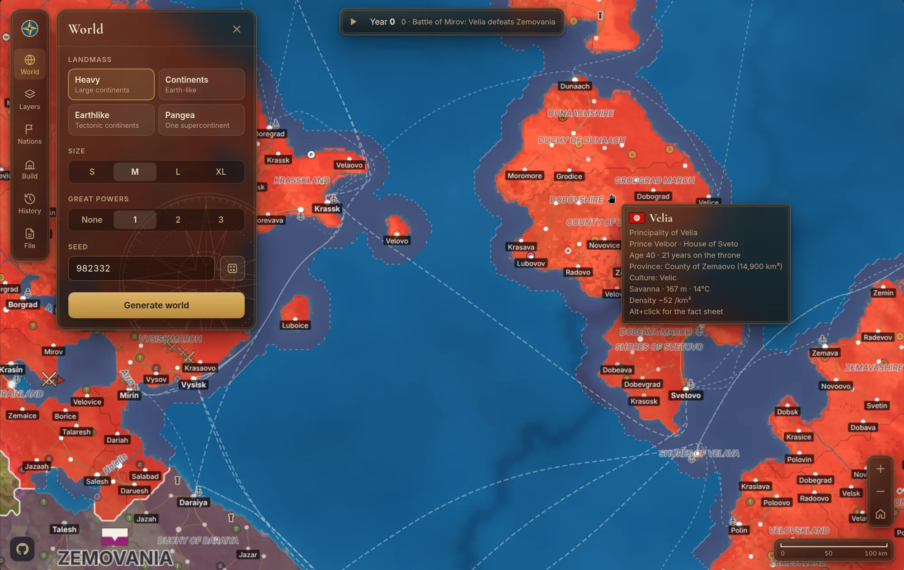
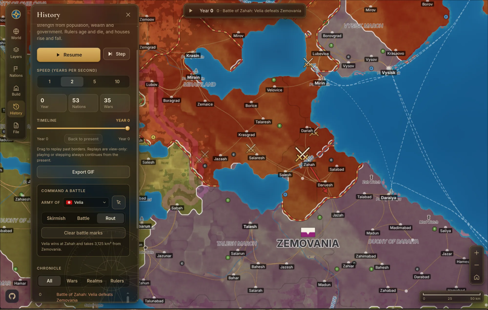
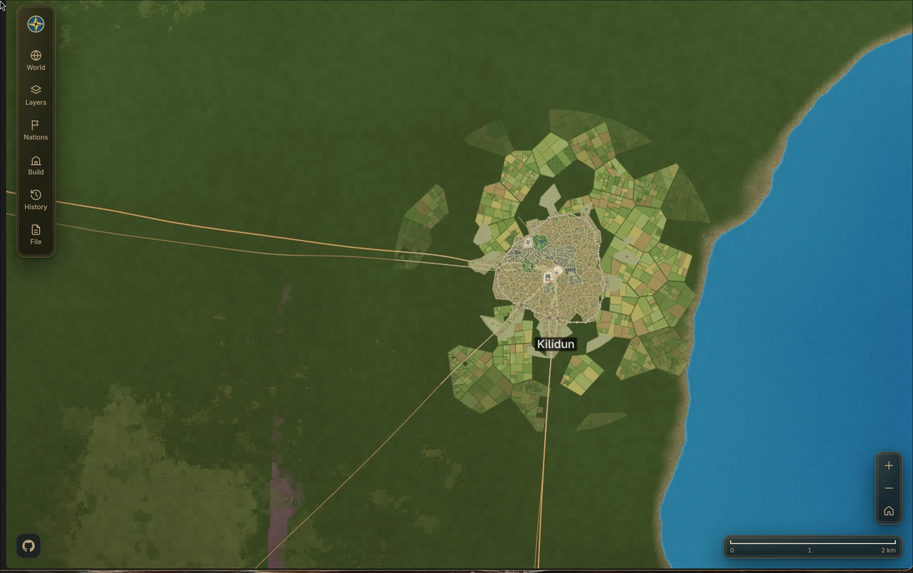
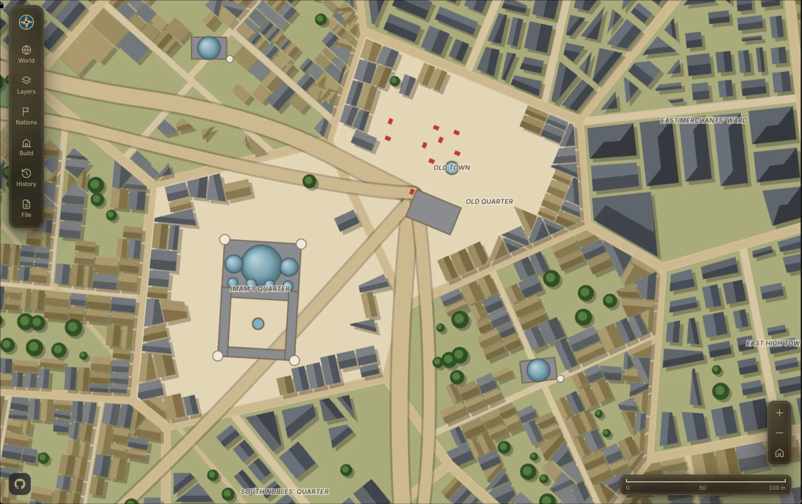

<div align="center">


# Fantasy World Map Generator

**Procedural worldbuilding maps with nations, cities, trade and simulated history, right in your browser.**

[](https://www.typescriptlang.org/)
[](https://vite.dev/)
[](https://www.khronos.org/webgl/)

### [Open the generator](https://khalidibnwalid.github.io/map-generator/)



<sub>A poster exported straight from the app (seed 982332, 800 × 450 cells of 5 km).</sub>

</div>

## What it does

Pick a seed and generate a whole world: tectonic continents, climate, rivers, biomes, then the people on top of it. Nations carve up the land, cities grow along rivers and coasts, caravans and ships trade between them. Press play and the world lives through centuries of war, collapse and succession.

Everything is deterministic. The same seed gives the same world, and a `.world` file is just the seed plus your edits.

## History simulation

Let time run. Nations settle empty land, fight over frontiers and break apart. Mountains, rivers and fortresses slow invaders. Scrub back through the timeline, read the chronicle, or export the whole run as an animated GIF.

<div align="center">

</div>

## Posters

Export any view as a high-resolution poster with a title, legend, compass rose and frame. Pick a single realm for a focused map, or the whole world.

<div align="center">

<sub>A single-realm poster: the Principality of Velia, with its neighbours dimmed.</sub>


<sub>The whole world in terrain view.</sub>
</div>

## Inspect and highlight

Hover any land to highlight its realm: its borders light up, and the waters it controls are shaded around its coasts. The tooltip shows the ruler and dynasty, province, culture, biome, elevation, temperature and population density. Alt+click opens a full fact sheet.

<div align="center">

</div>

## War mode

Take command of an army, pick a realm on the map and attack it there. Battles leave marks, arrows show the advance, conquered land changes hands, and the chronicle records the result.

<div align="center">

</div>

## From world to street

Zoom from a whole continent down to individual streets. Cities get procedural plans with walls, districts, markets, mosques and fields around them.

<div align="center">


</div>

## Features

**World generation**
- Earthlike tectonic continents, heavy landmass, realistic continents and Pangea presets
- Four map sizes from 400 × 225 up to 3200 × 1800 cells
- Rivers, lakes, coast distance fields, ocean currents, polar ice
- Rich biomes: deep ocean, taiga, steppe, marsh, savanna and more with smooth zoom transitions
- Temperature, moisture and population overlays

**Politics and society**
- Terrain-aware nations, provinces and cultures
- Generated flags with an in-app flag editor
- Great powers, vassal blocs and editable diplomacy
- Thematic maps: political, cultures, diplomacy and wealth

**Settlements and economy**
- Procedural city plans with level-of-detail rendering
- Roads, sea lanes and trade flows over land and water
- Landmarks and resources, settlements that grow, fall to ruin or get founded

**History**
- Year-by-year simulation of expansion, wars, battles and collapse
- Dynasties and rulers, plus a filterable chronicle
- Command your own battles with terrain-bound advances
- Timeline replay and animated GIF export

**Atmosphere and styles**
- Three map styles: Realistic, Historical and Atlas
- Seasons with snow, foliage and sea ice by month
- Night mode with moonlight and city lights, drifting weather

**Editing and export**
- Paint borders with an adjustable brush, add or delete nations, provinces and cities
- Print-ready poster export with title, legend, compass and frame
- Nation fact sheets
- Save and open `.world` files

## Run it locally

You need Node.js (LTS) and [pnpm](https://pnpm.io/).

```bash
git clone https://github.com/khalidibnwalid/map-generator.git
cd map-generator
pnpm install
pnpm dev
```

Then open the URL Vite prints. A browser with **WebGL2** is required.

| Command        | What it does                          |
| -------------- | ------------------------------------- |
| `pnpm dev`     | Start the dev server                  |
| `pnpm build`   | Type-check and build to `dist/`       |
| `pnpm preview` | Serve the production build locally    |

## Deployment

Every push to `main` publishes the site to GitHub Pages. See [DEPLOYMENT.md](DEPLOYMENT.md) for setup and details.

## Project layout

```
src/
  core/   WebGL2 renderer, noise, canvas and terrain sampling
  game/   generators, nations, politics, economy and the history simulation
  ui/     interface, layers, city and war renderers, poster and GIF export
public/   favicon set, web manifest, sitemap, robots.txt and social image
docs/     README images
```

## Tech

TypeScript, Vite, WebGL2, [simplex-noise](https://github.com/jwagner/simplex-noise.js) and [seedrandom](https://github.com/davidbau/seedrandom). No backend: everything runs client-side.

## Contributing

Issues and pull requests are welcome at [github.com/khalidibnwalid/map-generator](https://github.com/khalidibnwalid/map-generator).
